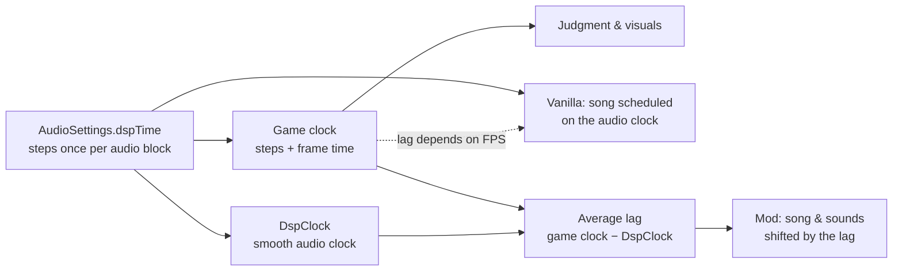

# CalibrationFixer

A Unity Mod Manager mod for **A Dance of Fire and Ice** that makes song timing independent of your frame rate and lets the calibration screen use async input.

> [!IMPORTANT]
> Recalibrate after turning the mod on or off. The audio moves by a few milliseconds, so your old input offset no longer fits.

## Features

| | Vanilla | With CalibrationFixer |
|---|---|---|
| Song and hit sounds vs. the game clock | Off by 0.5–15 ms, depending on FPS and audio buffer | Within ~1 ms at any FPS |
| Judgment code | — | Untouched |
| Calibration keyboard input | Frame-based (`Input.anyKeyDown`) | Async hook timestamp, same mapping as in-game async judgment |
| Calibration when the async hook gets no keys | — | Falls back to normal input |

## How it works

The game's clock (`scrConductor.dspTime`) follows `AudioSettings.dspTime`, which only moves once per mixed audio block. Between blocks the game adds frame time, so its clock runs behind the real audio clock, and how far behind depends on the frame rate. Judgment and visuals use the game's clock, but songs are scheduled on the real audio clock.



<details>
<summary>Details</summary>

- **`DspClock.Observe`** keeps the tightest offset between the audio clock and `Stopwatch` over the last 4 seconds. A block is always seen after it was mixed, so the largest offset is the closest to the truth. A new block was mixed after the previous frame, so each sample also gives an upper limit; older samples above it are dropped at once. This follows the audio clock when it loses time (an audio stall on restart).
- **`DspClock.ObserveLag`** averages *game clock − smooth clock* every frame. The first 400 frames are a plain average, so it settles within a few seconds after the game starts or the mod is turned on. After that, one frame can move it by at most 20 ms × 1/400.
- When the song is scheduled, that lag is frozen. The song, hit sounds, countdown ticks, hold sounds and `PlaySound` events are all moved by it. So they play exactly when the game's clock reaches their time.
- On the calibration screen, presses come from the SkyHook queue with their own timestamps. They are turned into song positions the same way a level does (`AsyncInputUtils.GetSongPosition`).

</details>

## Test results

`tests/` simulates the vanilla clock (block-stepped `dspTime` plus frame time) at different frame rates and audio buffer sizes. The numbers show how far the audio is from the game's clock, in milliseconds.

| Buffer | | 30 FPS | 60 FPS | 144 FPS | 240 FPS | 1000 FPS | Spread |
|---|---|---:|---:|---:|---:|---:|---:|
| 256 | Vanilla | −2.70 | −2.70 | −2.68 | −1.78 | −0.50 | 2.20 |
| | **Mod** | 0.00 | 0.01 | 0.03 | 0.03 | 0.02 | **0.03** |
| 1024 | Vanilla | −10.79 | −7.21 | −3.27 | −2.01 | −0.53 | 10.26 |
| | **Mod** | −0.40 | −0.04 | −0.13 | 0.00 | 0.01 | **0.41** |
| 2048 | Vanilla | −14.17 | −7.90 | −3.47 | −2.06 | −0.52 | 13.64 |
| | **Mod** | −0.11 | −0.39 | −0.13 | 0.01 | −0.08 | **0.40** |

An audio stall on restart, with the song scheduled 1 s later (400 FPS, buffer 1024):

| Stall | 5 ms | 20 ms | 63 ms | 300 ms |
|---|---:|---:|---:|---:|
| v1.0.0 | 3.08 | 12.41 | 38.07 | −1.21 |
| **v1.0.1** | 0.41 | 0.01 | −0.22 | −0.84 |

## Install

1. Install Unity Mod Manager for the game.
2. Download `CalibrationFixer.zip` from [Releases](https://github.com/square3ang/CalibrationFixer/releases/latest) and install it with UMM, or extract it into the game's `Mods/` folder.
3. Start the game and recalibrate.

> [!TIP]
> To use async input on the calibration screen, turn on **Asynchronous Input** in the game settings first.

## Build

Building needs the game installed. Set `GameRootDir` if your game is not in the default Steam folder on Linux.

```sh
dotnet build -c Release                     # builds and copies into Mods/CalibrationFixer/
dotnet build -c Release -p:GameRootDir="/path/to/A Dance of Fire and Ice/"
dotnet run --project tests                  # simulation tests
```

The UMM log shows `Song scheduled, audio shifted by X ms` each time a song starts. Use it to check the mod on your setup.

## Limitations

> [!WARNING]
> - With very low FPS and a large audio buffer (30 FPS, 2048 samples) about 0.4 ms of difference is left.
> - After a big FPS change, the lag average needs about 400 frames to settle (7 s at 60 FPS, 13 s at 30 FPS).
> - Async calibration needs the SkyHook keyboard hook (X11/XWayland on Linux). Without it, the calibration screen uses normal input.
> - Judgment itself is vanilla. The game's per-frame clock jitter and its async offset at the start of each attempt are not changed.

## License

[MIT](LICENSE)
